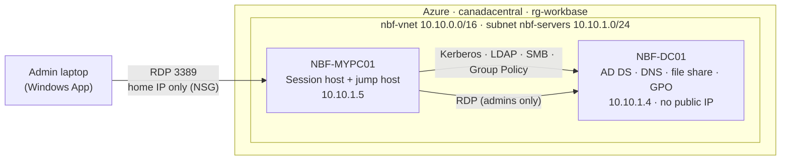
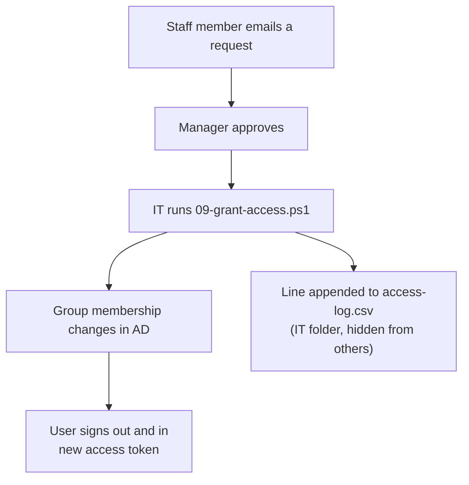
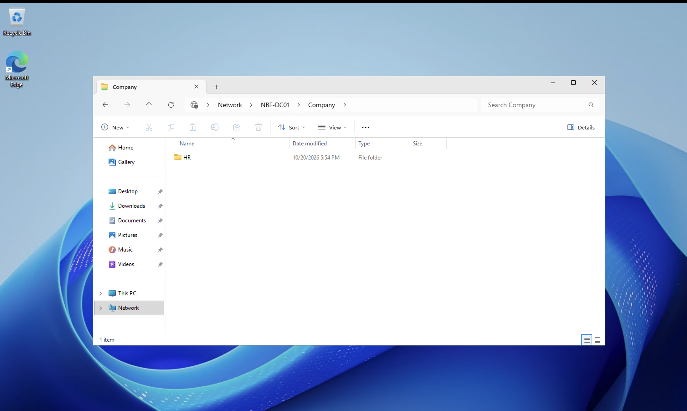
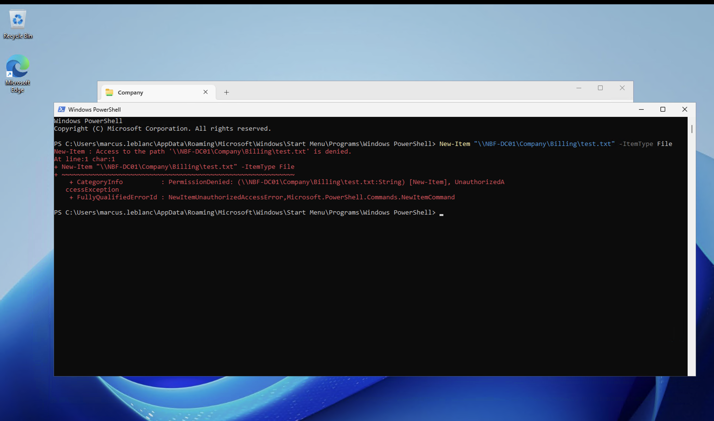
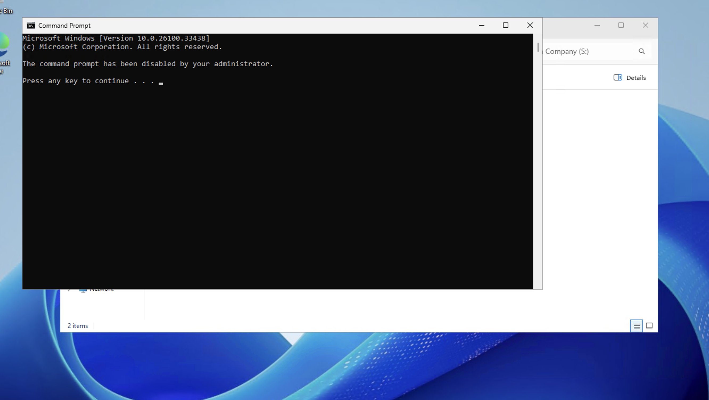
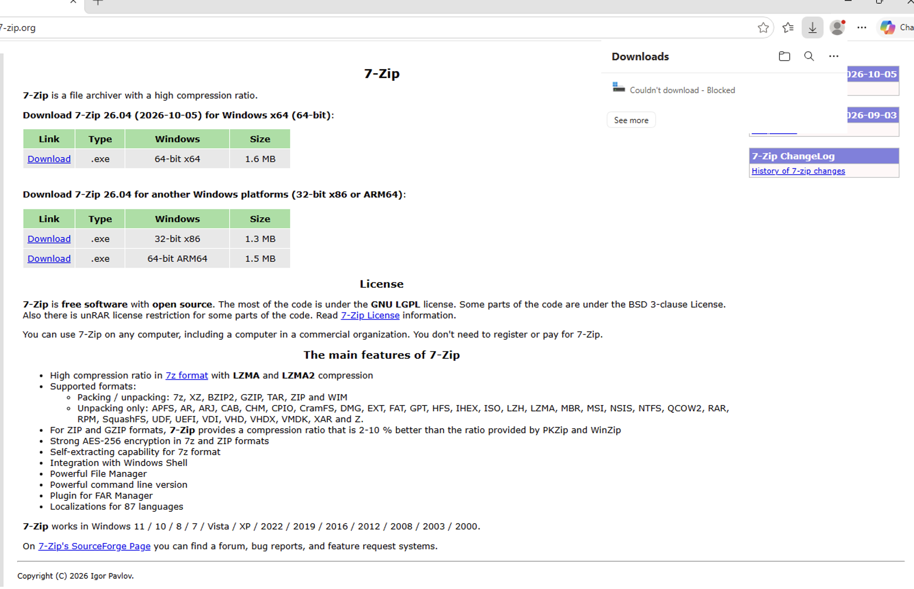

# WorkBase

Recreating the shared Windows desktop I used every day at a freight company, then modernizing it.

- **Part 1 — Enterprise Windows environment** (done): Active Directory, a multi-user session host, permission-controlled file shares, Group Policy, and a scripted access-request process. All on Azure, built with Terraform and PowerShell.
- **Part 2 — Modernize it** (next): Entra ID, Azure Files, Azure Virtual Desktop, Intune, and self-service access requests.

---

## The story

At my previous job I worked in billing at a trucking company. Every day, we signed in to one shared Windows "My PC" in the cloud with our company accounts. Each of us saw only the department folders we were allowed to open. We could not download files. When we needed access to another folder, we asked IT, and someone approved it.

I used that system for over two years without knowing how it worked on the admin side. WorkBase is me building it from scratch.

Fictional company: **Northbridge Freight Ltd.**, a trucking company in Windsor, Ontario.

---

## Architecture



| VM | Size | Role |
|---|---|---|
| NBF-DC01 | Standard_D2als_v6 | Domain controller (`northbridge.internal`), DNS, file share, GPOs |
| NBF-MYPC01 | Standard_B2s_v2 | Shared desktop (Remote Desktop Session Host), jump host |

Both VMs run Windows Server 2025 and shut down automatically at 23:00 Eastern.

---

## What I built

| Area | What | Script |
|---|---|---|
| Infrastructure | Resource group, VNet, NSG (RDP from my home IP only), 2 VMs, auto-shutdown | `terraform/` |
| Active Directory | New forest `northbridge.internal`, DNS forwarder to Azure DNS | `01`, `02` |
| Identity | OU tree, 6 staff users, 9 `SG-*` security groups | `03` |
| Shared desktop | Join MYPC01 to the domain in `OU=Session Hosts`, install the RDSH role | `04`, `05` |
| RDP access | `SG-MYPC-Users` → local Remote Desktop Users (later replaced by GPO) | `06` |
| File shares | One `Company` share, a folder per department, NTFS from `SG-*` groups, access-based enumeration | `07` |
| Group Policy | Staff lockdown (S: drive, no downloads, no Control Panel / cmd / regedit) and session host settings | `08` + GPMC |
| Access requests | Grant or revoke `SG-*` membership with a CSV audit log; refuses non-`SG-*` groups | `09` |

### Who sees what on the S: drive

Access-based enumeration hides any folder a user cannot open.

| User | Title | Sees | Can edit |
|---|---|---|---|
| sarah.mitchell | Billing Lead | Billing, Nightly Audits | Billing, Nightly Audits |
| daniel.okafor | Billing Analyst | Billing, Nightly Audits | Billing |
| marcus.leblanc | Billing Trainee | Billing | — |
| priya.sharma | Auditor | Nightly Audits | Nightly Audits |
| linda.chen | HR Coordinator | HR | HR |
| rishi.patel | IT Administrator | IT | IT |

Permissions are never given to a person directly. A user gets access by joining a group:

```
user → SG-* global group (AD) → NTFS permission on the folder
user → SG-MYPC-Users → local Remote Desktop Users on NBF-MYPC01 (via GPO)
```

### Group Policy

| GPO | Linked to | Settings |
|---|---|---|
| NBF-U-Staff-Lockdown | OU=Staff | Map `S:` to `\\NBF-DC01\Company`; block Edge downloads; block Control Panel, cmd, regedit |
| NBF-C-SessionHosts | OU=Session Hosts | Add `SG-MYPC-Users` to Remote Desktop Users (Update, not Replace); end disconnected sessions after 1 h, idle after 2 h |

### Access requests



Example from the log:

| Ticket | User | Group | Action | Reason |
|---|---|---|---|---|
| REQ-1001 | daniel.okafor | SG-NightlyAudits-Modify | Added | Cover for Priya during vacation |
| REQ-1002 | daniel.okafor | SG-NightlyAudits-Modify | Removed | Priya is back |

---

## Demos

**Linda (HR Coordinator) sees only the HR folder.** Access-based enumeration hides Billing, Nightly Audits, and IT.



**Marcus (Billing Trainee) can open Billing but cannot change it.** He is in `SG-Billing-Read`, not `SG-Billing-Modify`.



**Staff desktop lockdown from Group Policy.** The S: drive is mapped automatically, and the Command Prompt is blocked.



**Downloads are blocked in Edge**, like at my old job.



Other results (three sessions at once, the file-lock check with `Get-SmbOpenFile`, the token refresh after a group change, and the access log) are recorded as command output in `part1-enterprise/docs/notes.md`.

---

## How to rebuild

1. Create `part1-enterprise/terraform/terraform.tfvars` (not in the repo) with `subscription_id`, `my_ip`, and `admin_password`.
2. Before you apply, check VM quota (`az vm list-usage`) and capacity (`az vm list-skus`) in the region.
3. Run Terraform:

   ```bash
   cd part1-enterprise/terraform
   terraform init
   terraform apply
   ```

4. Run the scripts in order. Run each in Terminal (Admin) after `Set-ExecutionPolicy -Scope Process Bypass -Force`. Every script checks the hostname first, so it stops on the wrong server.

   | Script | Run on | Signed in as |
   |---|---|---|
   | `01-promote-dc.ps1` | NBF-DC01 | local admin |
   | `02-dns-forwarder.ps1` | NBF-DC01 | domain admin |
   | `03-create-ous-users-groups.ps1` | NBF-DC01 | domain admin |
   | `04-join-domain.ps1` | NBF-MYPC01 | local admin |
   | `05-install-rdsh.ps1` | NBF-MYPC01 | domain admin |
   | `06-allow-rdp-users.ps1` | NBF-MYPC01 | domain admin (optional, GPO does this) |
   | `07-create-file-shares.ps1` | NBF-DC01 | domain admin |
   | `08-create-gpos.ps1` | NBF-DC01 | domain admin |
   | `09-grant-access.ps1` | NBF-DC01 | domain admin, per request |

5. In `gpmc.msc`, add the two Group Policy Preferences items (drive map and local group). The steps are in `part1-enterprise/docs/notes.md`.
6. When finished: `terraform destroy`.

---

## Problems I hit

1. **NSG rule failed.** `curl ifconfig.me` returned my IPv6 address. Fixed with `curl -4` and an IPv4 validation rule on the `my_ip` variable.
2. **VM create failed: quota 0.** A new pay-as-you-go subscription had no quota for the B-series v2 families. Requested quota and changed sizes.
3. **VM create failed: `SkuNotAvailable`** for Standard_B2s (B-series v1 capacity restriction). Lesson: check both quota and capacity before every apply. Moved the DC to Standard_D2als_v6.
4. **`az vm list-usage` query error.** `limit` is a string in the output. Fixed with `to_number(limit)` in the JMESPath query.
5. **Ran the domain-join script on the DC by mistake.** The "already in this domain" check stopped it, so nothing changed. Added a hostname guard to every script.
6. **"You have been disconnected because another connection was made."** I ran `mstsc` to the DC from inside the DC session, so the DC connected to itself as the same user and took over my session. Fix: minimize the inner window to get back to the jump host. Rule: run `hostname` before anything.

---

## Lab shortcuts (what production does differently)

| In this lab | In production |
|---|---|
| One domain controller | At least two, in different availability zones |
| AD database on the OS disk | Separate data disk with host caching off |
| File share on the DC | Separate file server (or Azure Files in Part 2) |
| No RD Licensing server (120-day grace period) | RD Licensing server with RDS CALs |
| RDP from my home IP via NSG | Azure Bastion or VPN, no public RDP |
| Modify on a department folder also allows deleting that folder | Modify on subfolders and files only |
| PowerShell not blocked for staff | AppLocker or WDAC |
| One shared temporary password, no change at sign-in | Unique passwords, forced change, MFA |
| `.internal` domain, UPNs not routable | Add a routable UPN suffix before Entra Connect (Part 2) |

---

## Cost control

- VMs shut down automatically at 23:00 Eastern.
- I deallocated both VMs (never just "stop") when not working.
- The whole environment is code. I ran `terraform destroy` when Part 1 was finished and rebuild it when I need it.

---

## Part 2 — Modernize it (next)

| Part 1 (classic) | Part 2 (modern) |
|---|---|
| Active Directory only | Entra Connect sync → Entra ID (hybrid) |
| SMB share on the DC | Azure Files with identity-based access |
| Windows Server session host + RDP | Azure Virtual Desktop |
| Group Policy | Intune |
| Email request + admin runs a script | Self-service request → Logic App approval email → automatic group membership |

---

## Tools

Azure · Terraform (azurerm ~> 4.0) · Azure CLI · Windows Server 2025 · Active Directory · Group Policy · PowerShell · VS Code · Git / GitHub